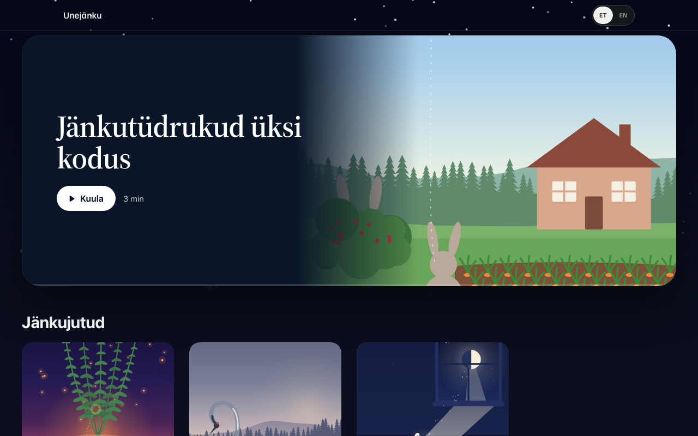

# khe-stories

[](https://github.com/khelias/khe-stories/actions/workflows/ci.yml)

**Unejänku** ("Sleepy Bunny"), the app the KHE family's bedtime stories are
read in: a library of stories, each read aloud in Estonian with its text
beside the audio, where listening resumes where it stopped and a story kept on
the phone plays offline. The stories chosen for publishing are live at
[khe.ee/stories](https://khe.ee/stories/).

[](https://khe.ee/stories/)

## How it works

This repo holds the code and a few invented demo stories. The family's own
stories are kept in a private repo, which builds this app at a pinned commit
with its own content. Why it is split this way:
[estate ADR-031](https://github.com/khelias/khe-architecture/blob/main/decisions/031-stories-public-app-private-stories-audio-outside-git.md).
How content plugs in is in [docs/content.md](docs/content.md).

The real stories are read by TartuNLP XTTS v2 in the children's dad's voice,
which the app's credit line names, with its licence. The code that reads them
aloud is in `reader/`, and how it was chosen and tuned is in
[docs/reader.md](docs/reader.md).

In the family build the children can also ask for a story of their own. A
small service in `server/` takes the request, has the private repo's job make
it, and tells the child's phone when it is on her shelf
([ADR-002](docs/decisions/002-a-request-service-beside-the-app.md)).

## Run it

Needs Node.js (the version in `.nvmrc`) and npm.

```bash
npm ci
npm run dev        # the public build over demo/ at http://localhost:5173/stories/
npm run build      # both builds into output/public and output/family
npm run preview    # serves output/public as the homelab does
```

Every other command is in [AGENTS.md](AGENTS.md).

## Where it runs

The app does not deploy from here: the private repo builds it and deploys it
to the homelab, to `stories.khe.ee` for the family, behind a login, and to
[khe.ee/stories](https://khe.ee/stories/) with the stories chosen for
publishing. The request service ships as its own container image, which
[khe-homelab](https://github.com/khelias/khe-homelab) runs.

## More

- [docs/content.md](docs/content.md) - the content contract
- [docs/decisions/](docs/decisions/) - the app's design decisions
- [docs/reader.md](docs/reader.md) - how the reader was chosen and tuned
- [AGENTS.md](AGENTS.md) - layout, commands and rules for working on the code

## Licence

The code is MIT-licensed ([LICENSE](LICENSE)). The demo audio in `demo/audio/`
is not: it is read by Pocket TTS Estonian in a voice cloned, with permission,
from the children's dad reading aloud, and all rights to it are reserved.
